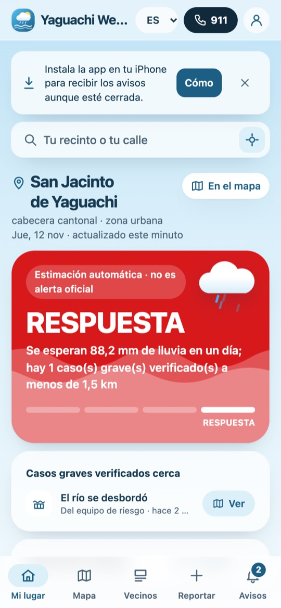
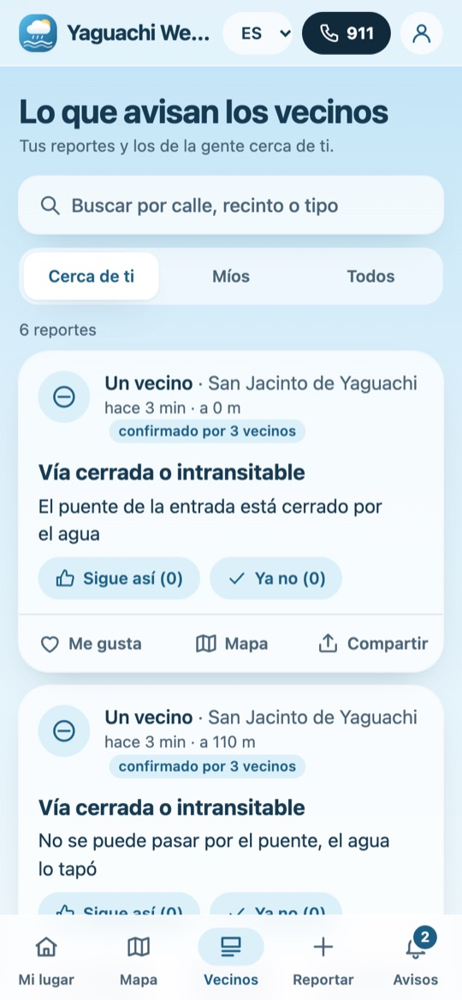
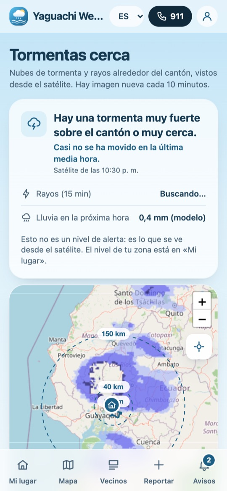
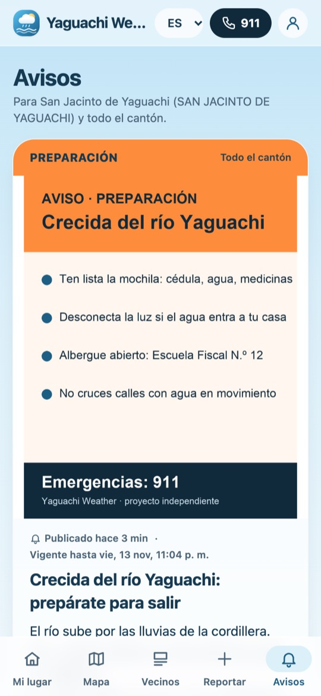
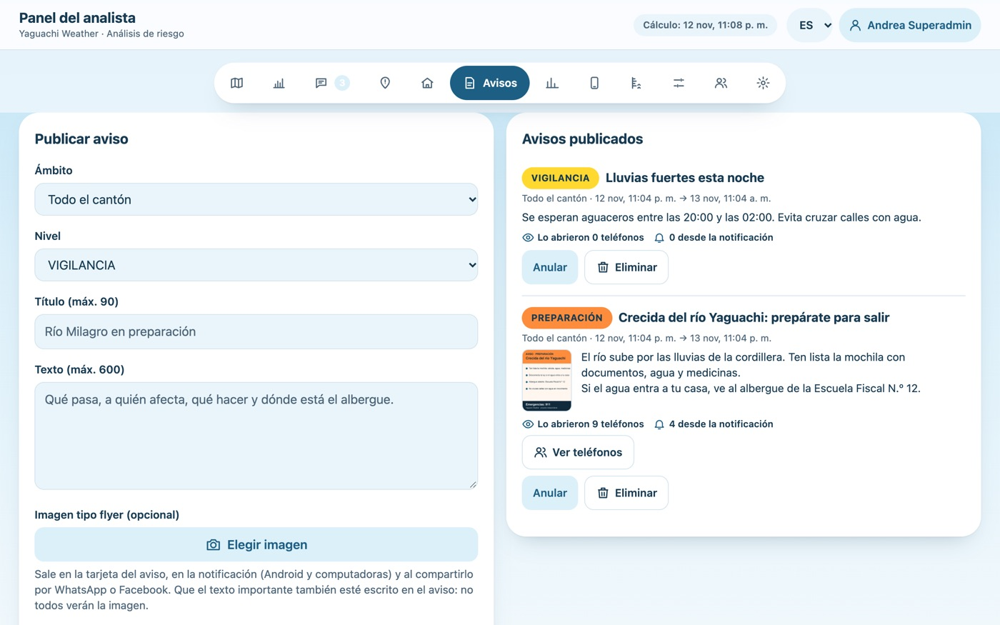
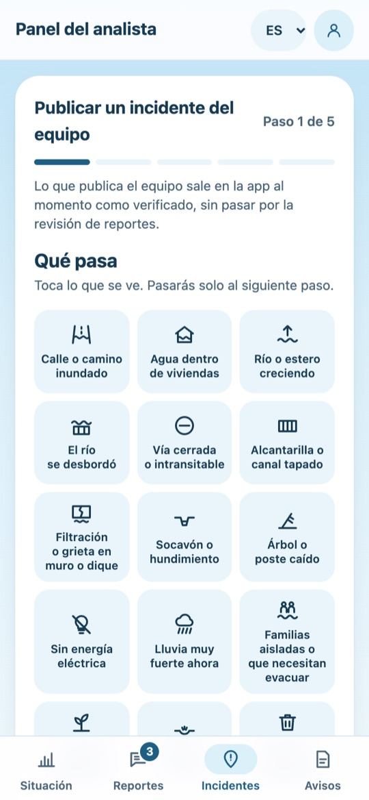
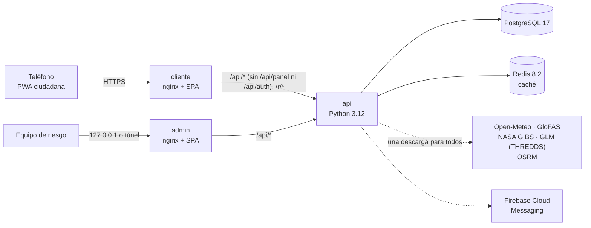

# Yaguachi Weather

**Plataforma abierta de alertas tempranas por inundación a escala cantonal**, construida para San Jacinto de Yaguachi (Guayas, Ecuador) y pensada para que otros cantones, parroquias o comunas la adapten.

Combina tres fuentes de información:
- **modelos hidrometeorológicos** (GloFAS y Open-Meteo);
- **mediciones de campo** (lecturas limnimétricas);
- **reportes ciudadanos**, con validación por el equipo y por los propios vecinos.

Con eso calcula un nivel de riesgo por río, recinto y calle, y lo entrega en una PWA instalable con notificaciones push.

[](LICENSE)


> **Aviso:** es un proyecto independiente y **no es un canal oficial**. Las alertas oficiales en Ecuador las emiten el COE cantonal, la Secretaría Nacional de Gestión de Riesgos y el INAMHI. Los niveles que calcula esta plataforma son estimaciones y así se presentan en la interfaz.

<p align="center">
  
  
  
  
</p>
<p align="center">
  
  
</p>
<p align="center"><sub>Capturas con datos de demostración ficticios. La imagen de tormentas es del satélite real.</sub></p>

---

## Contenido

- [Funcionalidades](#funcionalidades)
- [Arquitectura](#arquitectura)
- [Inicio rápido](#inicio-rápido)
- [Configuración](#configuración)
- [Motor de niveles](#motor-de-niveles)
- [API](#api)
- [Seguridad y privacidad](#seguridad-y-privacidad)
- [Calidad y pruebas](#calidad-y-pruebas)
- [Adaptarlo a tu cantón](#adaptarlo-a-tu-cantón)
- [Estructura del repositorio](#estructura-del-repositorio)
- [Contribuir](#contribuir)
- [Fuentes de datos](#fuentes-de-datos)
- [Licencia](#licencia)

---

## Funcionalidades

### App ciudadana (`cliente/`)

| Módulo | Qué hace |
|---|---|
| **Mi lugar** | Nivel estimado o verificado del recinto, la calle o la ubicación GPS. Muestra qué hacer según el nivel, la lluvia de 6 días, el río más cercano (caudal frente a P90, Q2 y Q5), los casos graves verificados cerca y las calles inundadas cercanas. |
| **Mapa** (Leaflet) | Ríos y recintos coloreados por nivel, tramos y zonas críticas, huellas de desborde, riesgo muy alto, puntos de control, reportes, incidentes y albergues. Trae la ruta a pie o en auto hasta el albergue. |
| **Tormentas cerca** | Nubes de tormenta del satélite GOES-19 (infrarrojo, banda 13), rayos del sensor GLM y lluvia de la próxima hora. Incluye la animación de las últimas 2 h, el rumbo de cada tormenta y anillos de 10, 40 y 150 km. |
| **Reportar** | Asistente de 4 pasos con 17 tipos de evento, gravedad, ubicación y foto opcional (se reduce en el teléfono a 1280 px). Se puede reportar de forma anónima. |
| **Calle inundada** | Se toca la calle en el mapa y el tramo se ajusta a la vía de OSM (±120 m). La altura del agua usa una escala propia de 3 valores, con la vereda como referencia. El aviso se publica al instante, dura 8 h y los vecinos lo confirman («sigue así» o «ya no»). |
| **Vecinos** | Muro de reportes con buscador y filtros (cerca, míos, todos), «me gusta» y botón para compartir. El enlace `/r/<id>` genera la vista previa en redes sociales. |
| **Avisos** | Avisos del equipo por cantón, parroquia, corredor de río o recinto, con flyer opcional. Llegan como **push** (Firebase Cloud Messaging) aunque la app esté cerrada y respetan las horas de silencio. |
| **Cuenta (opcional)** | Registro propio con nombre, cédula ecuatoriana validada, correo, contraseña y foto opcional. Sin cuenta, la app se usa completa. |
| **PWA** | Se puede instalar. Funciona sin conexión con la última información guardada y su caché está versionada para que cada despliegue llegue a todos los teléfonos. |
| **Idiomas** | Español e inglés en todo. |

### Panel del equipo (`admin/`)

Se publica en un servicio separado de la app ciudadana. Exige usuario, contraseña y captcha, y cada acción queda en la auditoría.

| Sección | Superadmin | Analista | Operador |
|---|:---:|:---:|:---:|
| Situación: nivel estimado frente a verificado por río y recinto; el nivel verificado se fija con un motivo obligatorio | ✓ | ✓ | ver |
| Reportes: verificar, resolver, descartar, cambiar vigencia, acciones en lote | ✓ | ✓ | ver |
| Incidentes del equipo: se publican al instante desde terreno | ✓ | ✓ | ✓ (los suyos) |
| Avisos: flyer, push, reglas anti-saturación y alcance (cuántos teléfonos lo abrieron) | ✓ | ✓ | ver |
| Albergues, reglas limnimétricas, lecturas de vigías, ajustes (INAMHI, aguaje) | ✓ | ✓ | — |
| Mapa en vivo y análisis: mapa de calor, horas pico, reportes sin atender, exportar a Excel | ✓ | — | — |
| Dispositivos: teléfonos que usan la app, por código y sin datos personales | ✓ | — | — |
| Usuarios y configuración: anonimato del equipo, validación por vecinos | ✓ | — | — |

Los permisos se definen en [`api/auth.py`](api/auth.py) (`ROLES`). La API es la que decide y responde `403 auth.permiso`; el frontend solo oculta lo que el rol no puede usar.

### Validación por vecinos

Un reporte se publica sin esperar al equipo cuando **N personas distintas** reportan el mismo tipo de evento en el mismo sector:
- **Valores por defecto:** 3 personas, a 300 m o menos, en las últimas 3 h. Se cambian en Configuración.
- **«Persona distinta»:** otro teléfono, otra IP y otra cuenta.
- **Cómo se publica:** como «confirmado por N vecinos», separado de «verificado». Sus fotos siguen privadas y no suben el nivel de la zona hasta que un analista lo verifique.

---

## Arquitectura



| Servicio | Imagen | Puerto | Rol |
|---|---|---|---|
| `cliente` | `node:22` (build) → `nginx:1.27-alpine` | `${PUERTO:-8090}` | App ciudadana. Pasa `/api/` y `/r/` a la API y **bloquea** `/api/panel` y `/api/auth`. |
| `admin` | `node:22` (build) → `nginx:1.27-alpine` | `127.0.0.1:${PUERTO_ADMIN:-8091}` | Panel del equipo. Nunca se expone en la interfaz pública. |
| `api` | `python:3.12-slim` | solo en la red interna | API REST, cálculo de niveles, tareas en segundo plano y push. |
| `db` | `postgres:17-alpine` | `127.0.0.1:5433` | Datos persistentes en el volumen `yaguachi-weather_pg`, con migraciones versionadas. |
| `redis` | `redis:8.2-alpine` | `127.0.0.1:6380` | Caché sin disco (`maxmemory 96mb`, `allkeys-lru`). |

**Decisiones técnicas:**
- **API sobre la biblioteca estándar.** Usa `http.server` con `ThreadingHTTPServer`; sus únicas dependencias son `psycopg[pool]`, `redis` y `firebase-admin` (opcional). Así hay menos superficie que mantener y la imagen sale liviana. Las migraciones están en [`api/esquema.py`](api/esquema.py).
- **El teléfono no habla con terceros.** La API baja una sola vez los datos de cada fuente externa (caudal, lluvia, satélite, rayos, rutas) y los sirve desde la caché. Un candado `SET NX` en Redis evita descargas duplicadas entre hilos o procesos. Si una fuente falla, se sirve la última copia buena marcada como `viejo`, y el fallo queda anotado 60 s para no reintentar en cada visita.
- **Si Redis no responde**, la API sigue con caché en memoria y vuelve a intentar cada 30 s.
- **Imágenes de satélite sin dependencias pesadas.** El PNG se decodifica y se codifica con `zlib` y `struct`, sin Pillow ni numpy.
- **Frontends:** React 19, TypeScript 6, Vite 8, Tailwind CSS 4 y Leaflet 1.9, organizados por funcionalidad (`src/features/*` y `src/shared/*`). El motor de idiomas se comparte entre los dos ([`compartido/i18n/`](compartido/i18n/)).

---

## Inicio rápido

### Con Docker

Requisitos: Docker con Compose v2.

```bash
git clone https://github.com/eliberiosoft/weather-project.git
cd weather-project
cp .env.example .env          # las variables vacías sirven para probar en local
docker compose up -d --build
docker compose logs api | grep "CLAVE INICIAL"   # clave del superadmin «admin», solo en el primer arranque
```

- App ciudadana: http://localhost:8090
- Panel del equipo: http://127.0.0.1:8091

En local, el captcha usa las claves de prueba de Cloudflare Turnstile y el push queda desactivado mientras no configures Firebase.

### Para desarrollar

Requisitos: Python 3.10 o superior, Node 22 o superior y Docker (para PostgreSQL).

```bash
sh iniciar-dev.sh     # PostgreSQL en :5433, API en :8095, app en :5173 y panel en :5174, con recarga en caliente
                      # en Windows: INICIAR_APP.bat
```

Para probar el GPS y las notificaciones desde un celular de la misma red (el navegador exige HTTPS):

```bash
sh iniciar-https.sh   # certificado local con mkcert y nginx en https://<IP-de-tu-PC>:8443
```

### Operación

| Tarea | Comando |
|---|---|
| Respaldo de la base | `docker compose exec db pg_dump -U yaguachi yaguachi > respaldo.sql` |
| Restablecer la clave de un usuario | `docker compose exec api python servidor.py --restablecer-clave admin` |
| Modo sin internet (usa lo último en caché) | `docker compose run --rm api python servidor.py --offline` |
| Despliegue continuo | GitHub Actions + usuario `deployer` por SSH: [docs/despliegue.md](docs/despliegue.md). El workflow no corre si falta la variable `DEPLOY_HOST`. |

---

## Configuración

Variables en `.env` (ver [`.env.example`](.env.example)):

| Variable | Uso |
|---|---|
| `PUERTO`, `PUERTO_ADMIN`, `PUERTO_DB`, `PUERTO_REDIS`, `PUERTO_HTTPS` | Puertos publicados. El panel, la base y Redis solo escuchan en `127.0.0.1`. |
| `POSTGRES_PASSWORD` | Clave de PostgreSQL (obligatoria en producción). |
| `URL_PUBLICA`, `COOKIE_SEGURA` | URL pública (para los enlaces compartidos) y cookie `Secure` detrás de HTTPS. |
| `TURNSTILE_SITE_KEY`, `TURNSTILE_SECRET_KEY` | Captcha del panel. Vacías = claves de prueba. Con `URL_PUBLICA` en HTTPS y sin clave secreta, la API rechaza todo ingreso al panel en vez de aceptar el captcha de prueba. |
| `FIREBASE_*` | Web push. Además va la cuenta de servicio en `secretos/firebase-cuenta-servicio.json`, que nunca se sube. Guía: [docs/firebase-y-captcha.md](docs/firebase-y-captcha.md). |
| `YAGUACHI_PROXIES` | Redes de confianza para leer `X-Real-IP`. Por defecto, las redes privadas de Docker. |
| `YAGUACHI_CAPAS`, `YAGUACHI_RUTAS` | Carpeta de capas GeoJSON y servidor OSRM (por defecto `routing.openstreetmap.de`). |

Los umbrales operativos están en `config.json`, dentro del volumen de datos ([`config.ejemplo.json`](config.ejemplo.json)): plazos de caché, límites por dispositivo, tamaño máximo de foto, días que se conservan las fotos, avisos por ámbito, horas de silencio y umbrales de lluvia. La validación por vecinos y el anonimato del equipo se cambian desde el panel.

---

## Motor de niveles

Hay cuatro niveles, **NORMAL → VIGILANCIA → PREPARACIÓN → RESPUESTA**, según los criterios §3.2 del plan de gestión de riesgos de inundación del cantón. En cada lugar manda el más alto que se cumpla:

| Fuente | Regla |
|---|---|
| **GloFAS** (51 miembros del ensamble, por la Flood API de Open-Meteo) | RESPUESTA si caudal > Q5 o P(>Q5) ≥ 50 % en 72 h · PREPARACIÓN si caudal > Q2, P(>Q2) ≥ 50 % o P(>Q5) ≥ 20 % en 30 d · VIGILANCIA si caudal > P90 o P(>Q2) ≥ 20 % en 30 d |
| **Regla limnimétrica** (medición) | Distancia al borde de desborde: > 2 m NORMAL, 2–1 m VIGILANCIA, 1–0,5 m PREPARACIÓN, < 0,5 m RESPUESTA. Subida ≥ 1 m en 24 h → VIGILANCIA; ≥ 0,3 m/h → PREPARACIÓN. Una lectura reciente manda sobre GloFAS, salvo que GloFAS dé RESPUESTA (entonces queda en PREPARACIÓN o más). |
| **Lluvia pronosticada** (Open-Meteo, celdas de 0,05°) | ≥ 50 mm en un día → VIGILANCIA · ≥ 100 mm en un día o ≥ 150 mm en 3 días → PREPARACIÓN |
| **Advertencia del INAMHI** vigente | Todo el cantón queda al menos en VIGILANCIA |
| **Aguaje** | Los ríos con influencia de marea suben un nivel en pleamar |
| **Reportes graves verificados** | Vivienda inundada, desborde o familias aisladas a ≤ 1,5 km → RESPUESTA |

- **Herencia del río:** un recinto o una calle a 1,5 km o menos del cauce hereda el nivel del río.
- **Nivel verificado:** el que fija el analista manda sobre el estimado, con esta precedencia: recinto, parroquia, corredor del río y cantón.
- **Lo que se dice en la interfaz:** que son datos de modelo y no mediciones. GloFAS trabaja con celdas de unos 5 km, no modela la marea y sobreestima los ríos pequeños.

---

## API

JSON sobre HTTP. Las rutas públicas son de solo lectura o tienen límites por dispositivo y por IP. Las del panel exigen la cookie de sesión, la cabecera `X-Requested-With: yaguachi` y el permiso del rol.

| Ruta | Uso |
|---|---|
| `GET /api/estado` | Niveles de ríos, recintos y puntos de control (caché de 2 min) |
| `GET /api/territorio` | Recintos, calles para el buscador, tipos de reporte y acciones por nivel |
| `GET /api/recinto?id=` · `GET /api/lugar?lat=&lon=` · `GET /api/cercano?lat=&lon=` | Detalle de un recinto o de un punto cualquiera |
| `GET/POST /api/reportes` · `POST /api/reportes/{id}/confirmar` | Listar y crear reportes (6 por hora y dispositivo, deduplicación a < 150 m en 30 min) y votos de vecinos |
| `GET /api/avisos` · `GET /api/albergues` · `GET /api/ruta` | Avisos vigentes, albergues y ruta hasta un albergue |
| `GET /api/tormentas` · `GET /api/tormentas/resumen` · `GET /api/tormentas/marco/<hora>.png` | Satélite, rayos, lluvia de la próxima hora y mosaico propio |
| `POST /api/push/suscribir` · `POST /api/push/baja` · `GET /api/push/config` | Web push |
| `POST /api/vistas` · `POST /api/actividad` | Alcance anónimo de avisos e incidentes, y uso de la app |
| `/api/cuenta/*` | Registro, ingreso, perfil y eliminación de la cuenta ciudadana |
| `/api/auth/*` | Sesión del panel: `config`, `login`, `logout`, `me`, `clave` |
| `/api/panel/*` | Panel: estado, nivel, reportes, incidentes, avisos, albergues, reglas, lecturas, ajustes, análisis, dispositivos, usuarios y configuración |

Los contratos detallados están en las especificaciones, por ejemplo [specs/014…/contracts/api.md](specs/014-usuarios-incidentes-push-react/contracts/api.md) y [specs/020…/contracts/api.md](specs/020-radar-tormentas/contracts/api.md).

---

## Seguridad y privacidad

**Seguridad**
- **Panel aislado:** el panel va en un servicio aparte, ligado a `127.0.0.1`. El nginx público responde 404 a `/api/panel/*` y a `/api/auth/*`.
- **Contraseñas:** scrypt (N = 2¹⁵, r = 8), con un tope de cálculos simultáneos para resistir abusos; mínimo 12 caracteres en el panel.
- **Sesión:** cookie `HttpOnly` y `SameSite`, cabecera anti-CSRF, captcha Turnstile y auditoría de cada acción.
- **Servidores web:** CSP estricta y cabeceras de seguridad en nginx; la IP real solo se acepta desde proxies de confianza.
- **Más detalle:** guía para publicar detrás de Cloudflare (Tunnel, Access, WAF) en [docs/seguridad.md](docs/seguridad.md).
- **¿Encontraste una vulnerabilidad?** No abras un issue: sigue la [política de seguridad](SECURITY.md).

**Privacidad** (Ley Orgánica de Protección de Datos Personales, LOPDP)
- **Sin cuenta, nada personal:** no se piden nombre, cédula ni teléfono. Cada teléfono usa un id aleatorio, y en el panel solo se ve una firma HMAC de ese id.
- **Fotos:** solo se publican si el equipo verifica el reporte, y se borran a los 90 días o al descartarse.
- **IP del envío:** se borra a las 48 h.
- **Tipo de teléfono:** se guarda la marca, la versión mayor del sistema y el formato, **nunca el modelo**.
- **Sin terceros:** no hay analítica externa, y el teléfono no se conecta con los proveedores de datos.

---

## Calidad y pruebas

```bash
# API: 193 pruebas (unittest) contra un PostgreSQL desechable; cada corrida crea y borra su base
docker run -d --rm --name yw-pg-pruebas -e POSTGRES_PASSWORD=pruebas -e POSTGRES_USER=yaguachi \
  -e POSTGRES_DB=yaguachi_pruebas -p 127.0.0.1:55432:5432 postgres:17-alpine
pip install -r api/requirements.txt
python -m unittest discover api/tests

# Frontends: ESLint + Vitest + build de producción
cd cliente && npm ci && npm run qa
cd ../admin && npm ci && npm run qa
```

Antes de dar por bueno un cambio, hay que pasar estas compuertas (definidas en la [constitución](.specify/memory/constitution.md)):
- `tsc`, ESLint y las pruebas en verde;
- los textos nuevos en `es` y en `en`;
- la versión del service worker subida (`VERSION` en `cliente/src/sw/sw.ts` y `admin/src/features/pwa/sw.js`);
- cada dependencia nueva justificada;
- el cambio probado en la app levantada;
- la revisión de interfaz con Impeccable en 0 hallazgos.

---

## Adaptarlo a tu cantón

Lo específico de Yaguachi son **datos**, no código:

1. **Capas** en [`compartido/capas/`](compartido/capas/) (GeoJSON WGS84):
   - `limite_canton`, `parroquias`, `recintos`, `rios`, `calles` y `equipamientos`;
   - las capas de riesgo: `riesgo_muy_alto`, `zonas_criticas`, `huellas_desborde` y `tramos_criticos`;
   - `puntos_control`: cada punto lleva `id`, `rio`, `lat_celda`/`lon_celda` (la celda de GloFAS) y sus umbrales `p90`, `t2` y `t5` (Q2 y Q5).

   [`preparar_capas.py`](preparar_capas.py) exporta las capas desde GeoPackage (EPSG:32717) con el `ogr2ogr` de QGIS.
2. **Ríos con marea:** `RIOS_MAREA` en [`api/servidor.py`](api/servidor.py).
3. **Umbrales y límites:** en `config.json`. Las acciones por nivel y los textos están en `compartido/i18n/`, `cliente/src/i18n/` y `admin/src/i18n/`.
4. **Nombre y marca:** en los textos i18n, en `PRODUCT.md`, en `DESIGN.md` y en los íconos de `cliente/public` y `admin/public`.

5. **Área del satélite:** el mosaico de tormentas cubre Ecuador, de Galápagos al oriente (`X0`, `X1`, `Y0` y `Y1` en [`api/tormentas.py`](api/tormentas.py), teselas de zoom 6). En Ecuador no hay que tocarlo; fuera del país se ajustan esas teselas.

El centro del cantón y la búsqueda de lugares salen solos de las capas. Si lo adaptas, nos encantaría saberlo: abre un issue con tu caso.

---

## Estructura del repositorio

```
api/                  API Python: servidor.py (rutas y niveles), esquema.py (migraciones), auth.py (roles),
                      usuarios.py, push.py, cache.py (Redis), tormentas.py (satélite y rayos), tests/
cliente/              App ciudadana: React + TS + Vite (src/features/*, src/shared/*, src/sw/), Dockerfile, nginx
admin/                Panel del equipo: React + TS + Vite, Dockerfile, nginx
compartido/           Motor de i18n común y capas GeoJSON
deploy/ · .github/    Despliegue por SSH con GitHub Actions
specs/ · .specify/    Especificaciones (Spec Kit) por funcionalidad y la constitución del proyecto
docs/                 Seguridad, despliegue, Firebase y captcha, capturas
compose*.yaml         Servicios de desarrollo, servidor y HTTPS local
PRODUCT.md · DESIGN.md   Para quién es el producto y su sistema visual
```

---

## Contribuir

Los **pull requests son bienvenidos**. El flujo:

1. Haz un fork y crea una rama `feat/…` o `fix/…` a partir de **`desarrollo`**.
2. Si cambia el comportamiento, documéntalo en `specs/NNN-nombre/` (spec, plan y tareas). El índice está en [specs/README.md](specs/README.md).
3. Pasa las compuertas de [Calidad y pruebas](#calidad-y-pruebas).
4. Abre el PR **contra `desarrollo`**, explicando el qué, el porqué y cómo lo probaste.

Ramas:
- **`desarrollo`**: integración; aquí llegan los PR.
- **`main`**: versión estable, que se publica con un *release*.

Las dos están protegidas: los cambios entran solo por PR aprobado por el dueño del repositorio.

Reglas que no se negocian:
- **Honestidad:** distinguir siempre lo estimado de lo verificado, y el modelo de la medición.
- **Privacidad por defecto.**
- **Ningún texto escrito directo en el código:** todo pasa por i18n.

---

## Fuentes de datos

| Dato | Fuente | Licencia o términos |
|---|---|---|
| Calles, recintos y equipamientos | © colaboradores de OpenStreetMap | ODbL |
| Lluvia y caudal | [Open-Meteo](https://open-meteo.com), con GloFAS de Copernicus/ECMWF | CC BY 4.0 |
| Nubes de tormenta | NASA GIBS, GOES-19 ABI banda 13 | Datos abiertos de NASA |
| Rayos | NOAA GOES-19 GLM, por el THREDDS de Unidata (UCAR) | Datos abiertos de NOAA |
| Rutas | OSRM ([routing.openstreetmap.de](https://routing.openstreetmap.de)) | Según sus términos de uso |
| Límite cantonal y parroquias | CONALI | Datos públicos |
| Capas de riesgo | Análisis propio, octubre de 2026 (HAND sobre Copernicus DEM 30 m, Sentinel-1, GloFAS) | Escenarios de planificación, no pronósticos de mancha |
| Mapa base | OpenStreetMap y Esri World Imagery | Según los términos de cada proveedor |

---

## Licencia

[MIT](LICENSE). Puedes usar, modificar y redistribuir el código, también en tu cantón, parroquia o comuna, conservando el aviso de la licencia. Las licencias de los datos de terceros son las de la tabla anterior.

> No se compite: se comparte una solución para ayudar a los demás. Una mejora funciona cuando hay **transparencia, solidaridad y pasión**.
